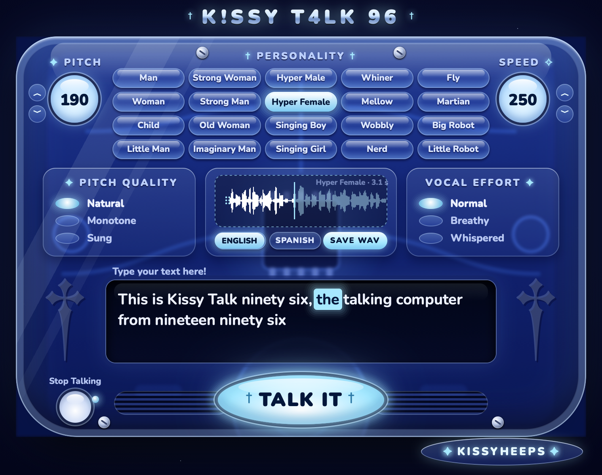

<h1 align="center">K!SSY T4LK 96</h1>

<b>Type a phrase. A 1996 computer says it.</b> 
Free VST3 / AU plugin · macOS + Windows · by <a href="https://instagram.com/kissyheeps">KISSYHEEPS</a>

<a href="../../releases/latest"><b>⬇ DOWNLOAD (free)</b></a>

---

## What is it
The singing, talking voice of the 1996 kids' CD-ROM era — now as a plugin.
Unofficial fan tribute to Microsoft Talk It! (1996), which never had a plugin version.

- 20 voices (singing, robots, whisper, kids, monsters…)
- English + Spanish
- Type → press Enter → it talks. The spoken word lights up.
- **Drag the phrase onto an audio track** — it becomes a WAV clip
- Works in Ableton Live, FL Studio, Logic, Reaper, Cubase and others

## Download
Go to **[Releases](../../releases/latest)** and download:

| You have | File |
|---|---|
| Mac (Apple Silicon or Intel), macOS 12+ | `KSSY_T4LK_96_v0.1.0_macOS.zip` |
| Windows 10/11, 64-bit | `KSSY_T4LK_96_v0.1.0_Windows_Setup.exe` |
| Manual | `KSSY_T4LK_96_Manual_EN.pdf` / `..._RU.pdf` |

## Install
**Mac:** open the zip → run the installer. If macOS says "unidentified developer":
System Settings → Privacy & Security → scroll down → **Open Anyway**.
Formats: AU + VST3 + standalone app.

**Windows:** run the Setup. If you see "Windows protected your PC": **More info → Run anyway**.
The VST3 goes to `C:\Program Files\Common Files\VST3`.

Then restart your DAW and rescan plugins. It is an **instrument**: K!SSY T4LK 96 (KISSYHEEPS).

The plugin is free and not signed — that is why the system warns you.

---

## Русский
**Напиши фразу — компьютер 1996 года её скажет.** Бесплатный плагин для Mac и Windows.

**[Скачать → Releases](../../releases/latest)**: Mac — `..._macOS.zip`, Windows — `..._Windows_Setup.exe`.

- Mac: если пишет «неустановленный разработчик» → Системные настройки → Конфиденциальность и безопасность → «Всё равно открыть».
- Windows: если «Система Windows защитила ваш компьютер» → «Подробнее» → «Выполнить в любом случае».
- Перезапусти DAW и пересканируй плагины. Волну с фразой тяни мышкой прямо на дорожку.

---

Unofficial, free, non-commercial. Not affiliated with or endorsed by Microsoft or SoftVoice.
The voice is an unofficial reconstruction of the SoftVoice engine; all rights to it remain with their owners.
Do not sell or re-upload for money. Rights holders: message Instagram or Telegram @kissyheeps and it will be taken down.
VST is a trademark of Steinberg Media Technologies GmbH. See LICENSE.txt.
